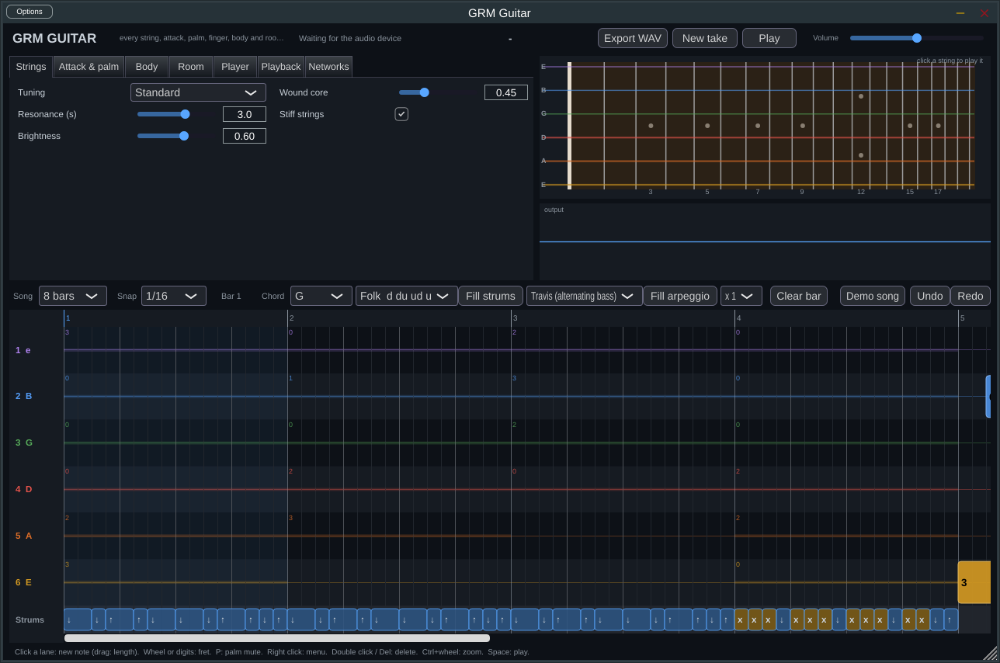

# GRM Guitar (plugin)

The guitar of [grm-core](https://github.com/innermost47/grm-core) as a VST3 / standalone instrument, built
with JUCE. Free software under the AGPL-3.0 (JUCE 8 is itself available under the AGPL-3.0).

Every part of the sound is a GRM network, the same ones as `grm_guitar.py`, ported to C++ and checked against
the Python numbers: the strings at every fret (tuning, inharmonicity), the attack (pick or finger), the palm
(exact modes of a string under a strip of skin), the fingers on the frets (lifting, landing, sliding on a wound
string), the player's arm (timing, force, pluck point, pick depth, palm), the body (air cavity coupled to the top,
bridge admittance, radiation) and the room (Eyring reverberation by band, critical distance, image sources).



## The guitar roll

A piano roll does not know that a guitar has six strings. The roll of the plugin has one lane per string
(string 1 on top, as in a tablature) and a lane of strums:
- a **note** is a fret on a string. It rings until its end, or until its string is played again: one string plays
  one note at a time, as on a guitar. The faded part of a note shows what the next note on that string cuts off.
- a **strum** is a chord shape swept by the pick, down or up. The player network decides when the pick reaches
  each string and how hard (an upstroke often misses the bass).
- when a string changes fret, the left hand lifts from the old fret (the string jumps back to open: a soft pluck)
  and lands on the new one (a knock); on a wound string the finger makes its noise. "Finger noises" turns this off.
- palm mute per note or per strum; dynamics (pp to ff) per note or strum. "Palm pressure" at 0 lifts the palm:
  palm-muted notes ring free. "Palm mute (live)" lays the palm on everything at once, the roll included: what
  rings is damped as the palm lands.
- a note that ends dies as a player stops it: a fretted note as the finger relaxes, an open string more slowly
  (a hand has to touch it), the strings of a chord one after the other, and the high modes first (it darkens
  as it dies). Before a new shape the fingers move as late as they can, so the notes ring until then.
- in a loop, the end of the roll leads into its start: the fingers change shape for the first notes at the end.
- the hands are constraints, as on a real guitar (`core/playability.hpp`): the left hand has four fingers (the
  thumb can take the low E), a barre is one finger, and its stretch is a GRM network (fingertips behind their
  frets against the hand's natural spread; the frets come closer up the neck, so more frets fit there). Fret 3
  with fret 7 is hard but possible, fret 3 with fret 8 is not. A pick cannot strike two strings without the ones
  between. The roll refuses an edit that asks for something no guitarist can play, says why, and marks the
  moments already impossible (a red mark on the ruler).
- the pick sweeps: each string it pushes aside takes some of the hand's energy, so the pick slows and the later
  strings of a chord get a little less (a slow, soft strum fades across the chord, a fast one hardly). Notes
  struck together with a pick are one sweep; single notes are picked down on the sixteenths of the beat and up
  between (alternate picking). With the fingers, notes together are a pinch: the thumb slightly first, each
  finger its own force.
- the arm tires: every stroke costs an effort it recovers from in about two seconds; a long run of sixteenths
  ends a little softer and slower, a stroke after a rest comes out fresh.
- the palm is a hand, not a switch per string: it covers the strings asked and presses half as hard on their
  neighbours, presses harder on a harder stroke, and stops the strings ringing under it when it lands.
- "New take": the player network plays the same roll again with new imprecisions ("Human feel" off: exactly the grid).

Editing: click a lane to add a note (drag to set its length); click a note or strum to select it, drag to move
every selected object (also to another string), drag the right edge to resize them. Ctrl+click adds to or removes
from the selection, Ctrl or Shift+drag on an empty place draws a selection rectangle, Ctrl+drag on a note copies.
Ctrl+A select all, Ctrl+C / Ctrl+X / Ctrl+V copy, cut, paste (at the last place clicked, also between two
instances), Ctrl+D duplicate after the selection, Ctrl+Z / Ctrl+Y undo, redo, Esc deselect. Arrows move the
selection by a grid step (Shift: a bar; Shift+up/down: to the next string), up/down alone change the fret, digits
type it, the mouse wheel too, P palm mute, Del or double click delete. Right click: the same as a menu.
Ctrl+wheel zooms, Space plays. Click the ruler to choose a bar: "Fill strums" and
"Fill arpeggio" write the patterns of the Python sequencer there with the chosen chord.

The roll follows the host's position and tempo when the host plays; otherwise (standalone, or host stopped) the
Play button runs it at the "Tempo (standalone)" parameter. The roll is saved with the project. MIDI keeps working
at the same time: a key goes to the string that plays it lowest on the neck, or, with "MIDI to strings: Channel =
string", channel 1 to 6 picks the string (1 = high E).

## Architecture

- `core/grm.hpp`: the GRM engine in C++ (header only), the same algorithm as `grm.py` step by step.
- `core/guitar_networks.hpp`, `core/physics.hpp`: every network of `grm_guitar.py`.
- `core/model.hpp`: everything the networks give for the current settings, solved off the audio thread
  (strings and attack in about 40 ms, the 120 palm networks and the room in about 0.5 s).
- `core/song.hpp`, `core/performance.hpp`: the roll, and the roll turned into what the hands do (player network,
  attack per stroke, palm per stroke, lifts, landings, finger noises).
- `core/voice.hpp`, `core/engine.hpp`: the real-time part. Each string is a bank of up to 80 modes pushing on the
  bridge (losses inside the string, through the bridge, under the palm; overdamped modes under the palm; the palm
  pressure released during the stroke). The strings nobody plays answer the others through the bridge
  (sympathetic strings: driven resonators, V = Y(f) F). Its output is the force on the bridge in newtons.
- The plugin then convolves it with the body and room impulse responses made from their networks
  (`juce::dsp::Convolution`, stereo room: one tail per ear).
- Networks are solved in a background thread; the audio thread takes finished results between two blocks,
  without locks or allocation (`grmg::Mailbox`).

## Tests

- `test_core`: 210 checks that the C++ GRM gives the same numbers as the Python (values to 1e-9, uncertainties to 1e-6).
- `test_play`: how it is played (palm lifted, loop, notes that end, live palm, the hands' limits and every
  built-in chord shape, the sweep, the pinch, the muscle, alternate picking, the palm's band).
- `test_physics`: 137 checks for the body, bridge admittance, room, palm, finger, action, player and strum networks,
  and the sound of one string (C++ voice vs `synthesize_string`: same to 1e-8 without the palm, to about 0.5 %
  with it, where the C++ updates the palm's recovery every 16 samples).
- `render_offline [out.wav]`: the whole path without a host (model, roll, engine block by block, body, room).
- `plugin_host_test [out.wav]`: the plugin's own processor called as a host would (MIDI, state save and load).
The expected numbers are made by `tools/make_golden.py /path/to/grm-core`.

Measured here (Linux, one core, 48 kHz): the strings use about 8 % of one core playing the demo roll, the whole
plugin with the living-room convolution about 11 %.

## Build (Windows)

Needs Visual Studio 2022 (C++ workload), CMake 3.22+ and Git. JUCE is downloaded by CMake.

```bat
cmake -B build -G "Visual Studio 17 2022"
cmake --build build --config Release
ctest --test-dir build -C Release
```
The plugin is in `build\GRMGuitar_artefacts\Release\VST3\GRM Guitar.vst3` (copy it to
`C:\Program Files\Common Files\VST3`), the standalone in `build\GRMGuitar_artefacts\Release\Standalone`.

Linux: the same commands with the default generator (needs the ALSA, X11, Xrandr, Xinerama, Xcursor, freetype and
fontconfig development packages).

Validation: [pluginval](https://github.com/Tracktion/pluginval), `pluginval --strictness-level 5 --validate "GRM Guitar.vst3"`.

## Known limits

- The palm mute uses the exact modes of the strip model, but it does not sound like a real palm mute yet.
- Live MIDI playing has no finger noises (they are computed for the roll, off the audio thread).
- The church impulse response is 6 s long: its convolution costs more CPU than the smaller rooms.

## Next

- Presets (guitars, string sets, rooms), MIDI export of the roll, MIDI import into the roll.
- Copy / paste and multiple selection in the roll; slides and hammer-ons as techniques; TuxGuitar import.
